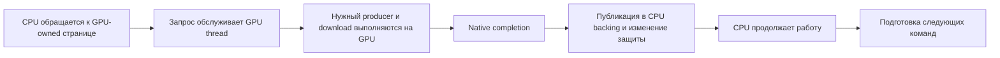

# Почему Ghost of Yōtei работает примерно на 3,8 FPS

Дата: 2026-10-13. Native Windows, `G:\repos\KytyPS5`, ветка
`yotei-integration-native`. Исследован код `fd11eba2` и сохранённые реальные
запуски. WSL остановлен; последующая проверка работающих дистрибутивов вернула
пустой список и exit 0. В ходе этого исследования игра и сборки не запускались.

## Основной вывод

Наиболее обоснованный диагноз — сочетание дорогого переведённого GPU-прохода,
частых обменов данными CPU↔GPU и большого объёма подготовки ресурсов на CPU.
Один выключатель дебага или сокращение холостого цикла проблему не объясняет.
Однако точная критическая цепочка конкретного кадра ещё не установлена:
суммировать длительности разных потоков и вложенных функций нельзя.

Чистые замеры по заголовку окна дают приблизительно 3,6–3,9 FPS в игровом мире.
3,8 FPS соответствует ориентиру 263 мс на кадр; 60 FPS требует 16,7 мс.
Это разница примерно в 16 раз, поэтому небольшой CPU-фикс сам по себе не
обосновывает обещание 60 FPS. Эти величины — ориентиры из FPS, а не полный
разбор измеренного среднего времени кадра.

## Что измерено

### Обычные запуски без тяжёлой диагностики

Все строки ниже — завершённые 30-секундные замеры заголовка после кадра 650,
нейтральный контроллер, полный рендер, без переходов по меню. Серии различаются
ревизиями; прямые пары на одном executable отмечены отдельно.

| Изменение | Средний FPS | Вывод |
|---|---:|---|
| До уменьшения окна write-fault readback, `3a8a74e6` | 3,611 | Контроль одной пары |
| Окно write-fault включено, `ac0ac772` | 3,839 | +6,3% в одной паре; стабильный прирост не подтверждён |
| Тот же executable, убрать `DEBUG_UNBUFFERED` | 3,750 | Значительного выигрыша от буферизации лога нет |
| Тот же executable, буферизация + label interval 4000 вместо 2000 мкс | 3,866 | Около +3% к предыдущему запуску, существенного выигрыша нет |
| `a533ee3d`, recorder spin 2000 | 3,862 | Контроль на одном executable |
| Тот же executable, recorder spin 100 | 3,821 | Уменьшение spin не ускорило игру |

Артефакт: `_Build/analysis/yotei-performance-cycle38-20261013/clean-title-config-comparison.json`.
Название FPS проверено в `window.cpp`: оно вычисляется через FrameStatistics
и реальный QueryPerformanceCounter, а не берётся из изображения или счётчика
компилированных шейдеров.

### CPU: реальные конечные функции

Запуск `game-20261013-135940-diag-cycle40-sampled-function-profile-bb6889`:
`fd11eba2`, EXE `AE228D2366B103DB09C495BE50BEC84E4297A675D6F1E690EB946758E40D8C9C`.
Профиль длится 10,1963867 с, кадры 650→689, 26 зарегистрированных потоков,
165 строк. Ошибок CPU-запросов, обрезанных/незавершённых замеров и переполнения
регистра нет. Игра закрылась с exit 0, защита памяти не срабатывала.

Это диагностический запуск, его FPS не является контрольным результатом.
Реально подключена 31 точка входа функций и дополнительные точки ожиданий и
callback; 41 значение enum не означает 41 отдельно измеренную функцию.

| Участок | Вызовы за окно | Выборочное среднее wall time | Что это означает |
|---|---:|---:|---|
| `DrawIndex` | 183 246 | 31,18 мкс с дочерними; 8,60 мкс после их вычитания | Большой поток работы; остаток включает неразмеченные вызовы и расходы измерения |
| `DispatchDirect` | 118 197 | 38,38 мкс с дочерними; 8,19 мкс после их вычитания | Подготовка compute тоже существенна |
| `GetGraphicsPrograms` | 184 856 | 4,42 мкс | Наиболее ясный CPU-кандидат для подробного разбора stage preparation / cache / SRT |
| `PrepareBindings` | 402 152 | 2,42 мкс после вычитания дочерних | Повторная подготовка ресурсов |
| `RebindBuffers` | 402 152 | 2,86 мкс после вычитания дочерних | Повторные привязки/проверки буферов |
| `SynchronizeBuffer` | 1 197 687 | 1,05 мкс после вычитания дочерних | Много bookkeeping; это не 1,2 млн реальных копирований |
| `UploadCopies` | 1 197 687 | 0,18 мкс | Есть ранний выход при пустом списке; CPU-замер близок к уровню пустой пробы |

Средняя пустая CPU-проба на CP — около 1586 сырых циклов. `UploadCopies`
показывает около 1777 циклов, поэтому объявлять его главным CPU bottleneck
по сумме необработанных циклов было бы ошибкой. `GetGraphicsPrograms` показывает
около 16 349 циклов на выборочный вызов и существенно выше этого порога.
CPU-циклы нельзя переводить в CPU-миллисекунды по частоте процессора.
[Контракт Microsoft QueryThreadCycleTime](https://learn.microsoft.com/en-us/windows/win32/api/realtimeapiset/nf-realtimeapiset-querythreadcycletime).

Оценка `GetGraphicsPrograms` по числу вызовов и выборочному wall-среднему —
примерно 21 мс на диагностический кадр. Это ориентир для выбора следующего
профиля, не доказанная экономия и не независимый участок критической цепочки.
Подготовленные inputs, clean hints и stream reuse в коде уже существуют;
предложение просто добавить их повторяло бы имеющуюся реализацию.

### CPU↔GPU: ожидания и публикация

В профиле одного рабочего потока `ReadMemoryAsync` имеет выборочное среднее
1,249 мс с дочерними вызовами и 5,835 мкс после их вычитания. Основная задержка
здесь относится к ожиданиям, а не к вычислению тела этой функции.
На другом потоке публикация буфера занимает около 21,19 мкс на выборочный
вызов; ожидание native fence — около 350,25 мкс. Эти числа не складываются:
публикация и ожидание происходят на разных потоках.

В отдельном cycle33 диагнозе за 108 кадров зарегистрировано примерно
128 readback-запросов и 21,10 MiB упакованного staging на кадр.
66,89% этих байтов приходится на настоящие CPU write faults. Это доля трафика,
не доля времени кадра и не объём всех PCIe/GPU-копирований.
Уменьшение синтетического чтения 65548→12 байт успешно проверено, но не дало
сопоставимого роста FPS: размеры копий не определяют всю задержку.

Если такая цепочка становится необходимой для следующих команд кадра,
она ограничивает перекрытие CPU и GPU. Это рабочая гипотеза, подтверждённая
реальными ожиданиями, но её вклад в критический путь надо измерить через
связанный request→producer→publication→resume trace.

### GPU: стоимость проходов и промежутки между работами

В одном сохранённом cycle24 диагностическом интервале при **3,0 FPS**:

| Категория | Диагностический интервал, мс/кадр |
|---|---:|
| Compute dispatch | 54,71 |
| Buffer-copy | 37,65 |
| Tiler/detiler | 21,56 |
| Draw | 15,12 |
| Image-copy | 8,13 |

GPU command-buffer interval union — 144,37 мс/кадр; промежутки между этими
интервалами — 188,88 мс/кадр. Вместе это соответствует примерно 333 мс того
диагностического кадра. Их нельзя вычитать из 263 мс другого чистого запуска.
TOP/BOTTOM timestamps включают зависимости; zone timestamps могут ограничивать
перекрытие работ. Поэтому это не чистое время ALU шейдеров и не потолок
производительности обычного запуска.

Наиболее важны сразу две задачи: удешевить реальную GPU-работу и выяснить,
почему она подаётся с промежутками. Низкая загрузка CPU или неполная загрузка
GPU сама по себе не выбирает между подготовкой, ожиданием данных и зависимостями.
Одна Vulkan queue не означает работу одного GPU-ядра; порядок и зависимости
влияют на доступное перекрытие, а не задают число shader cores.
[Правила исполнения и синхронизации Vulkan](https://docs.vulkan.org/spec/latest/chapters/synchronization.html).

## Почему запуск на PS5 и другие игры не доказывают 60 FPS здесь

PS5 использует собственный AMD RDNA2 GPU и системную GDDR6.
[Официальные характеристики Sony](https://blog.playstation.com/archive/2020/03/18/unveiling-new-details-of-playstation-5-hardware-technical-specs/).
Эмулятор добавляет явно видимые в коде операции: преобразование tiled layouts,
копирование и публикацию GPU-данных в CPU backing, дополнительные операции
двух половин wave64 там, где эта модель применяется, и реализацию строгих
DS float min/max через CAS. Сравнивать только мощность видеокарт недостаточно.

Работа другой игры подтверждает совместимость её нагрузки. Она не доказывает,
что Yōtei использует тот же объём compute, тот же рисунок CPU/GPU владения и
те же зависимости. Контрольной другой игры в этой серии нет. Сообщение о
~7 FPS в другом форке относится к другому человеку и не является сравнением
на этом ПК с теми же настройками/сценой.

## Что сейчас не подтверждается

- **Дебаг как основная причина.** Validation, дампы, тяжёлые GPU/CPU timers были
  выключены в чистых замерах. Проверка буферизации stdout существенного роста
  не дала. Профайлер выключен по умолчанию.
- **Один CPU/GPU core как объяснение.** CP и recorder имеют отдельные потоки;
  старый отдельный диагностический замер дал около 53,7% и 29,8% одного CPU
  ядра соответственно. Эти средние не доказывают насыщение или отсутствие
  коротких всплесков. GPU-occupancy/register-spill данных пока нет.
- **Переполнение VRAM в исследованной сцене.** Cycle33 показывал около
  11,7 GiB usage при бюджете 14,1 GiB, запас около 2,4 GiB; retired image pool
  занимал около 27,7 MiB. Это не доказательство отсутствия любой residency
  проблемы, но обвинять этот pool в paging по имеющимся данным нельзя.
- **Дорогие BUFFER short-store atomics.** Проверка actual SPIR-V опровергла
  гипотезу: соответствующие записи уже native16. CAS относятся к DS float
  min/max, а не к этим buffer stores. Даже весь FC6 интервал около 9,2 мс
  не объясняет остальную стоимость кадра; это не время его отдельных atomics.
- **Просто увеличить frames-ahead.** `GetGpuFramesAhead` сейчас имеет
  определение и декларацию без production-потребителя; такой переключатель
  не является рабочей оптимизацией.

WSL мог ухудшать отдельные запуски давлением на RAM; один запуск действительно
прервался по защите памяти. Но при выключенном WSL чистые замеры всё равно
оставались примерно на 3,8 FPS, поэтому только его остановка проблему не решает.

## Порядок дальнейшей работы

1. **Установить критическую зависимость кадра.** Короткий ограниченный trace
   для sampled readback-запросов: запрос CPU, начало GPU service, реальный
   producer tick, submit, native wait, публикация и продолжение потребителя.
   Проверить, какие запросы реально блокируют подачу следующей работы. Прежде
   чем убрать ожидание, доказать synthetic A-ready/B-unrelated и обратные
   случаи с новым A writer/image alias/старыми токенами.
2. **Разобрать `GetGraphicsPrograms` и writable synchronization.** Отдельно
   измерить подготовку/adoption, mutex wait, cache hit/miss, refresh/SRT и
   read-validation. У синхронизации посчитать пустые проходы, реальные uploads,
   written/texel flags, hot-page epoch и вычисления protection masks. Возможный
   небольшой общий фикс — идемпотентный GPU-dirty переход под существующим
   lock после CPU-conflict проверки, при отсутствии armed/stale страниц.
   Чистую read-only проверку код уже содержит. Все ownership/protection,
   callback и validation операции сохраняются.
3. **Изолировать главные GPU-группы.** Sparse native timestamps с чтением
   только естественно завершённых запросов, без новых Flush/Finish. Для
   конкретного tiler/copy/compute участка — synthetic workload с полными
   входами и точными native outputs; неполный FC6 capture не дополнять нулями.

После каждого доказанного общего исправления: native regression и соседние
случаи, затем одна переменная за раз, чистый 30-секундный замер title FPS,
повторный A/B/A при видимом росте. Изображение проверять после существенного
роста, как просил пользователь. Не выдавать сокращение счётчика или микробенча
за выигрыш игры. Queue1 не включать до writer provenance, reverse dependencies
и source lifetime proof; required eager/linear/raw coherence не отключать.

Полные эффекты и 60 FPS не достигнуты. В этом исследовании новых исправлений
рендера, запусков игры, публикаций GitHub и проверки изображения не было.

## Артефакты

- CPU: `_Build/runs/game-20261013-135940-diag-cycle40-sampled-function-profile-bb6889/function-profile-analysis.json`.
- GPU: `_Build/runs/game-20261013-065805-diag-hot-fc6f8c56eb7e168f-dfda43/stdout.txt`, строки 12704–12733.
- Readback: `_Build/analysis/yotei-performance-cycle33-20261013/readback-byte-diagnostic/runtime-byte-attribution.json` и `runtime-write-fault-waits.json`.
- Проверка настроек: `_Build/analysis/yotei-performance-cycle38-20261013/clean-title-config-comparison.json`.
- Проверка WSL: `_Build/analysis/yotei-performance-research-20261013/wsl-state.json`.
- Независимые разборы трёх агентов: `_Build/analysis/yotei-performance-research-20261013/{cpu,gpu,sync}.md`.
- Прогресс и незавершённые доказательства: `ghost-of-yotei-windows-plan.md`, `emulator-test-debt.md`.
